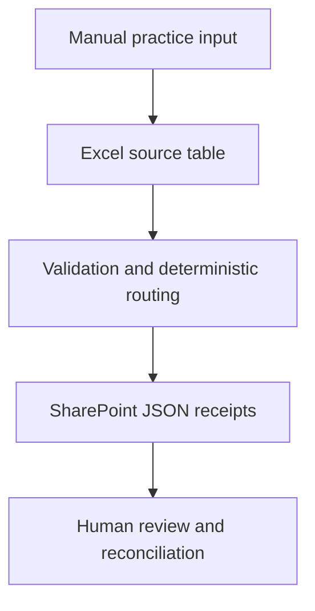

# Architecture

Prepare conditional messages with optional attachments, suppress previously contacted or prepared records, and hold uncertain or missing-attachment cases.

This flow contains no email-send action. PreviewReady is recorded as Prepared only after its receipt is written; the real-contact count stays unchanged. A repeated run should suppress Prepared records. The sample supports one campaign per unique EmployeeId. Cross-flow writers and crash-safe exactly-once delivery are not implemented.

The manual input schema and complete action graph are in `flow/`. Only standard SharePoint and Excel actions carry out service operations. There are no HTTP or email-send actions. Conditions and loop operations use Power Automate expressions.

Intake and certifier responses are separate records. Certification joins on RequestId + Revision, suppresses stale revisions, and flags duplicate or ambiguous records. A one-account practice environment does not prove that reviewers and submitters have separate permissions. A production solution needs explicit access design, ownership, retention, error handling and a transaction-safe uniqueness strategy.

The current import preserves the seed connection configuration as invoker connections: the runner supplies authorized SharePoint/Excel connections. Do not broaden access to make a demo run.
