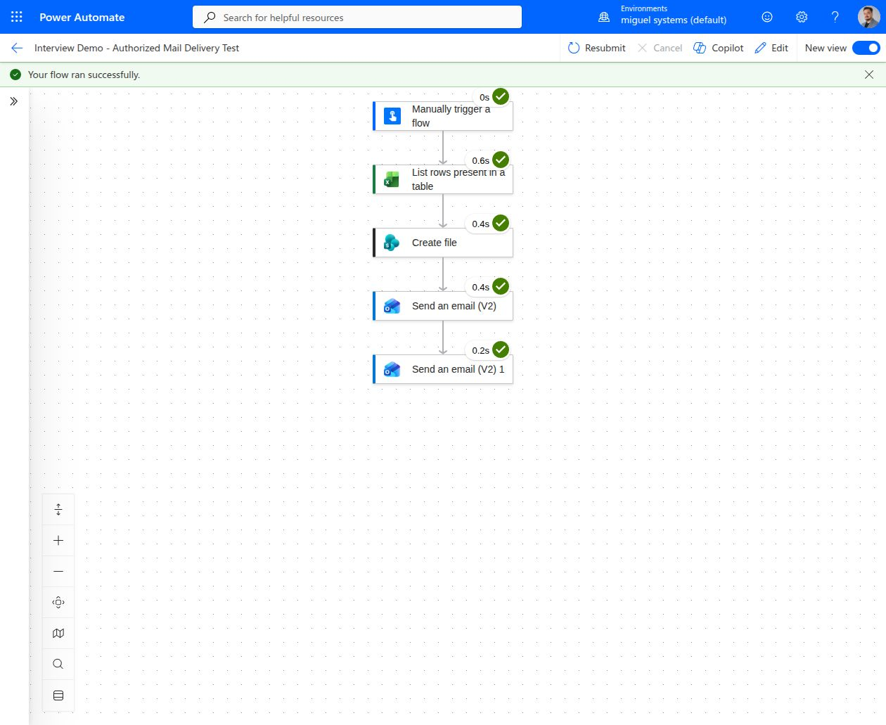
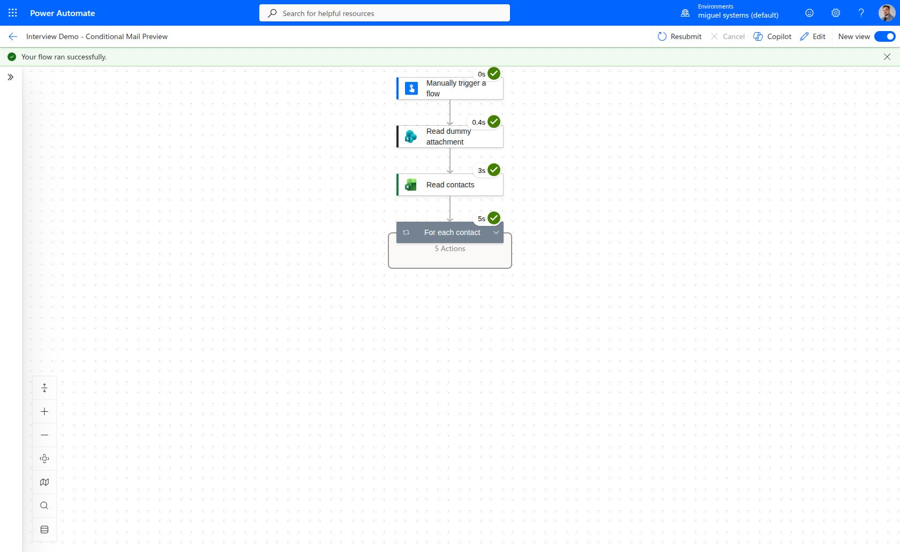

# Validation record

Test date: November 17, 2026, America/Chicago (November 18 UTC). Synthetic private tenant practice.

- Native package import: successful.
- Baseline flow run: **Succeeded**.
- Run identifier: `08584066439434975436525839128CU31`.
- Real emails: **0**.
- Native output reconciliation: see `validation/baseline/`, `expected-baseline.json`, and `python3 scripts/verify_receipts.py`.
- Further checks: native repeat run succeeded and E001/E002 were suppressed as already prepared.

Actual Power Automate run trace, captured after the service reported success. File values are independently reconciled because successful execution alone does not prove correct business outcomes.

This flow contains no email-send action. PreviewReady is recorded as Prepared only after its receipt is written; the real-contact count stays unchanged. A repeated run should suppress Prepared records. The sample supports one campaign per unique EmployeeId. Cross-flow writers and crash-safe exactly-once delivery are not implemented.

Local reference simulation separately passed 17 checks across the original suite. That result is not the native Microsoft run result. Native screenshots and JSON previews are separate evidence. The sanitized portable configuration has not been tested in a second tenant.

## Owner-authorized delivery test

A separate manual flow sent exactly two synthetic messages to the owner-controlled mailbox: one without an attachment and one with `demo-action-guide.txt`. Both Outlook actions succeeded in one run, and Outlook search verified both received messages at 01:05:51 UTC on November 18. Both send actions used retry policy None. The test flow was turned Off afterward. See `validation/delivery-test.json` and [delivery setup](DELIVERY-TEST.md). This confirms the transport and attachment payload independently of the preview routing logic; it does not establish integrated exactly-once sending.

